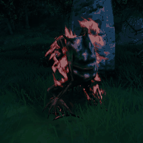
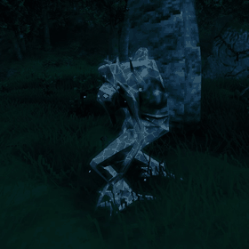
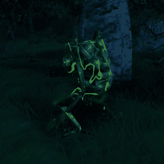
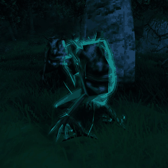
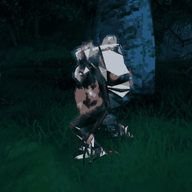
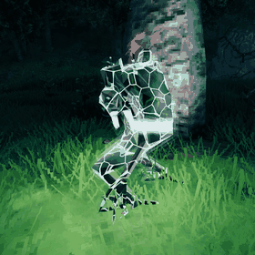

# ElementalOverhaul

A Valheim mod that draws elemental status effects (fire, frost, poison, lightning, spirit) **on the creature's body** instead of stacking one particle cloud and glow light per element on top of it. Pairs of elements get their own combo effect, and all five at once trigger a special one.

| Fire | Frost | Poison |
|---|---|---|
|  |  |  |
| **Spirit** | **Steam (fire + frost)** | **Ragnarok (all five)** |
|  |  |  |

Captured in game at night. The player-facing description, combo list and settings are in [mod/package/README.md](mod/package/README.md), which is also the Thunderstore page.

## How it works

- **Skin shader.** A shader drawn over the creature's skinned mesh with a command buffer: a multiply pass (soot, frost tint, hollow spirit), a light pass (flames, ice cracks, veins, arcs, rims), and optional shell passes floating just above the skin. Each element owns a different part of the look, so stacks stay readable.
- **Surface particles.** A few particles per element emitted from the creature's own mesh. Fire clones the game's flame system, because its gradient-mapped material needs the vanilla custom data streams.
- **One light per creature,** blended from the active elements and flashing in sync with lightning bursts.
- **Combos** pick the strongest enabled element pair (or all five) and fade the parents' own looks by `Combos.Replace`.
- **Single source of truth.** Every tunable lives in `shader/src/params.json`, and the look lives in `shader/src/overlay.glsl`. `shader/tools/gen.py` generates the Unity HLSL include, the BepInEx config bindings (`mod/Params.g.cs`) and the browser preview's shader from those two files. Don't edit generated files.

## Layout

| Folder | What |
|---|---|
| `mod/` | The BepInEx plugin (C#, net472). `pack.sh` builds the Thunderstore zip into `mod/dist/`. |
| `shader/` | Unity 6000.0.75f1 project that compiles the overlay shader into per-platform asset bundles (`build.sh`). |
| `testbed/` | QETestbed, a developer plugin that boots straight into a throwaway test world. See below. |
| `shader/preview/` | Browser preview used for fast iteration. It needs data extracted from your own game install, which isn't committed. |

## Building

Requirements: .NET SDK, Valheim, BepInExPack_Valheim, Python 3, and Unity **6000.0.75f1** (the game's version) with Linux and Windows build support.

```sh
# shader bundles (runs gen.py first), copied into your r2modman profile
PROFILE=/path/to/r2modman/profile shader/build.sh

# the plugin
cd mod && dotnet build -c Release -p:GameDir=/path/to/Valheim -p:Profile=/path/to/r2modman/profile

# Thunderstore zip
mod/pack.sh
```

Paths default to the author's machine. Override `GameDir` and `Profile` for your own setup.

## Testing in game: QETestbed

The testbed does nothing unless Valheim is launched with `-qetest`. With it, the game skips the intro and menus and loads a throwaway local character and world, both named `qetest`. Your real saves aren't touched. The player is invincible and ignored, and an AI-less, unkillable Greydwarf is placed in front of the camera. Commands go one per line into `BepInEx/plugins/QETestbed/testbed.cmd`, and each one is acknowledged in `testbed.log`:

```
spawn Troll 1                 apply fire,frost        cam 2.6 0 1.2
time 0.1                      env Clear               hud off
shot name                     record name 36 12       quit
```

`apply` respawns fresh dummies and keeps real status effects on them through the game's own code. `record` writes frames for GIFs. The mod's config reloads live, so settings can be tuned while the game runs.

## License

MIT. Valheim and its assets belong to Iron Gate. No game assets are included in this repository.
